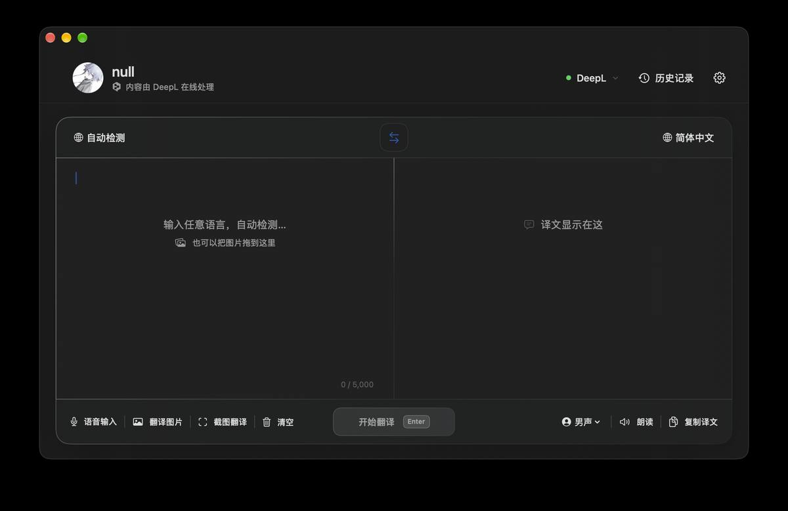
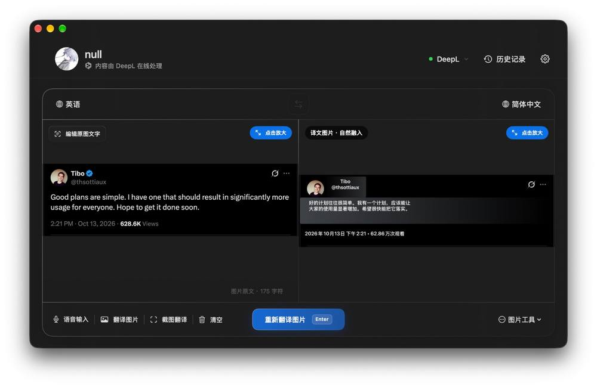

# Yike for Mac

简洁高效的 macOS 原生翻译应用：文字翻译、图片翻译、截图翻译、语音输入，菜单栏常驻、划词即译。

## 界面预览

### 主界面



### 翻译引擎切换（Apple 系统翻译 / DeepL）


### 划词翻译弹窗


### 图片翻译（译文自然融入原图）



### 账号与安全


## 功能

- **双翻译引擎**：DeepL 高质量翻译（需自填 API Free 密钥）+ Apple 系统翻译（macOS 15+，离线可用）
- **划词翻译**：全局快捷键，在任何应用中选中文字即弹窗翻译
- **图片翻译**：拖入图片或截图，OCR 识别后把译文自然融回原图
- **语音输入**：Apple 语音识别 + 内置离线 Whisper 引擎
- **菜单栏常驻**：关闭窗口不退出，随手即用
- **自动更新**：新版下载后校验 SHA-256 与代码签名，失败自动回滚

## 系统要求

- macOS 13 或以上，Apple Silicon（arm64）
- Apple 系统翻译需要 macOS 15 或以上（低版本自动只用 DeepL）

## 安装

从 [Releases](https://github.com/a17746168234-alt/Yike-for-Mac/releases) 下载最新 `.dmg`，
打开后把 Yike 拖进 Applications 即可。

> 应用为 ad-hoc 签名，首次打开如被 Gatekeeper 拦截，
> 请在「系统设置 → 隐私与安全性」中允许打开。

## 从源码构建

需要 Xcode Command Line Tools 与 CMake：

```bash
bash native/build.sh
```

构建产物在 `outputs/Yike-macOS-arm64.dmg`。
首次构建会下载固定版本的 whisper.cpp 源码并编译内置语音引擎。

测试：

```bash
bash native/tests/run_tests.sh
```

## 说明

- DeepL 需要用户自行填写 API Free 密钥（设置 → 账号与安全），密钥只保存在本机系统钥匙串。
- 公共体验账号与自动更新接口由自有服务端提供。

## 开源协议

MIT，详见 [LICENSE](LICENSE)。
